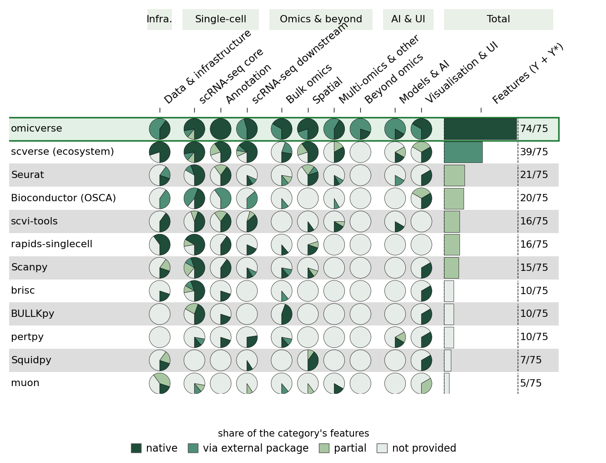
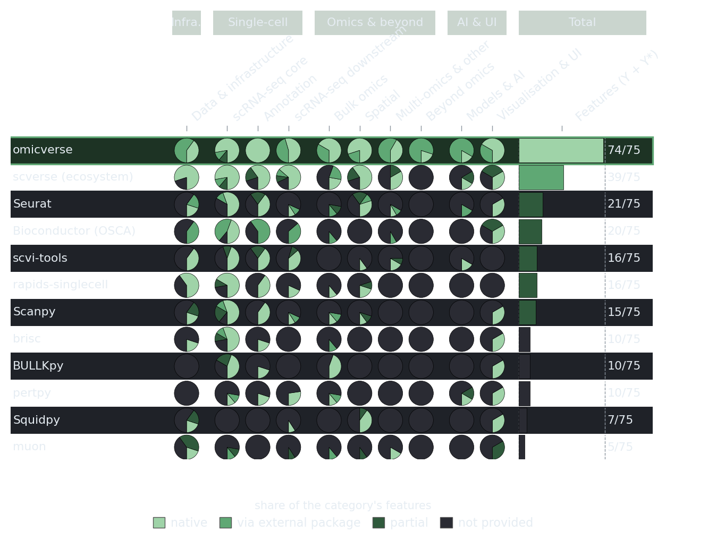

# Feature coverage

OmicVerse covers single-cell, bulk, spatial and other omics in one package. The figure compares its coverage with the scverse ecosystem and ten other frameworks over 75 analysis features in 10 categories; each pie shows the share of a category's features that a tool provides natively, through a separately installed package, partially, or not at all.

## How the table was built

- Codes: **Y** native (everything needed installs with the package, or is vendored); **Y\*** through a separately installed package or CLI that the package calls or documents as its workflow; **P** partial; **N** not provided.
- Every cell was checked against the latest release (omicverse 2.4.2, Scanpy 1.12.5, Seurat 6.0.0, rapids-singlecell 0.18.1, brisc 0.2.5, scvi-tools 1.5.2, Squidpy 1.8.4, muon 0.2.1, pertpy 1.5.0, Bioconductor 3.23 (OSCA), BULLKpy 0.3.0; scverse core also Scirpy 0.26.1, SnapATAC2 2.10.0, decoupler 2.3.1, AnnData 0.13.4, MuData 0.4.1, SpatialData 0.8.0) and has a function name and a source or docs link in the evidence table.
- **scverse (ecosystem)** takes, for each feature, the best code among the scverse core packages (Scanpy, Squidpy, muon, scvi-tools, pertpy, rapids-singlecell, Scirpy, SnapATAC2, decoupler, AnnData, MuData, SpatialData), i.e. the ecosystem counted as one toolkit.
- The 75 features span the scope of OmicVerse, so specialised packages (e.g. Squidpy for spatial, muon for multimodal data, pertpy for perturbations) cover fewer of them by design. One cell was adjusted by the reviewer for consistency (see rule_adjustments in the evidence notes).

Files: [coverage table](_static/feature_coverage/feature_table.tsv) · [per-cell evidence](_static/feature_coverage/feature_evidence.tsv) · [coding rules](_static/feature_coverage/rules.txt)

## Full table

● native · ◐ via external package · ◔ partial · empty: not provided

| Category | Feature | omicverse | scverse (ecosystem) | Scanpy | Seurat | rapids-singlecell | brisc | scvi-tools | Squidpy | muon | pertpy | Bioconductor (OSCA) | BULLKpy |
|---|---|:-:|:-:|:-:|:-:|:-:|:-:|:-:|:-:|:-:|:-:|:-:|:-:|
| Data & infrastructure | Raw reads to counts | ◐ |  |  |  |  |  |  |  |  |  |  |  |
| Data & infrastructure | Out-of-memory / on-disk data | ◐ | ● | ◔ | ◐ | ● |  | ● | ◔ | ◔ |  | ◐ |  |
| Data & infrastructure | GPU acceleration | ◐ | ● |  |  | ● |  | ● |  | ◔ |  |  |  |
| Data & infrastructure | Multithreaded CPU kernels | ● | ● | ● | ● |  | ● |  | ● | ● |  | ◐ |  |
| scRNA-seq core | QC metrics and filtering | ● | ● | ● | ● | ● | ● |  |  | ◔ |  | ● | ◔ |
| scRNA-seq core | Doublet detection | ● | ● | ● |  | ● | ● | ● |  |  |  | ◐ |  |
| scRNA-seq core | Ambient RNA removal | ◐ | ● |  |  |  |  | ● |  |  |  | ◐ |  |
| scRNA-seq core | Normalization and HVG selection | ● | ● | ● | ● | ● | ● | ◔ |  |  |  | ● | ● |
| scRNA-seq core | Batch integration | ● | ● | ● | ● | ● | ● | ● |  |  |  | ◐ | ● |
| scRNA-seq core | Clustering and embedding | ● | ● | ◐ | ● | ● | ● |  |  | ◐ |  | ● | ● |
| scRNA-seq core | Marker genes and differential expression | ● | ● | ● | ● | ● | ◔ | ● |  |  | ● | ● | ● |
| scRNA-seq core | Pseudobulk differential expression | ● | ◐ | ◔ | ◐ | ◔ | ◐ |  |  |  | ◐ | ◐ | ◔ |
| Annotation | Reference-based annotation | ● | ● | ● | ● | ● | ● | ● |  |  |  | ◐ |  |
| Annotation | Marker-database annotation | ● | ● |  |  |  |  | ● |  |  |  | ◐ |  |
| Annotation | LLM-based annotation | ● |  |  |  |  |  |  |  |  |  |  |  |
| Annotation | Gene set scoring | ● | ● | ● | ● | ● |  |  |  |  | ● | ◐ | ● |
| scRNA-seq downstream | Trajectory and pseudotime | ◐ | ● | ● | ◐ |  |  | ◔ |  |  |  | ◐ |  |
| scRNA-seq downstream | RNA velocity | ◐ | ● |  |  |  |  | ● |  |  |  | ◐ |  |
| scRNA-seq downstream | Cell-cell communication | ● | ● |  |  | ● |  |  | ● |  |  |  |  |
| scRNA-seq downstream | Gene regulatory networks | ◐ | ● |  |  |  |  |  |  |  |  |  |  |
| scRNA-seq downstream | Metacells | ● | ◔ |  |  |  |  |  |  |  |  |  |  |
| scRNA-seq downstream | Copy-number inference | ◐ |  |  |  |  |  |  |  |  |  |  |  |
| scRNA-seq downstream | Cell metabolism | ● |  |  |  |  |  |  |  |  |  |  |  |
| scRNA-seq downstream | Perturbation analysis | ● | ● |  | ● | ● |  | ● |  |  | ● |  |  |
| scRNA-seq downstream | Differential abundance / composition | ● | ● |  |  |  |  | ● |  |  | ● | ◐ |  |
| Bulk omics | Bulk RNA-seq differential expression | ● | ◐ |  |  |  | ◐ |  |  |  | ◐ |  | ● |
| Bulk omics | Co-expression networks | ● |  |  |  |  |  |  |  |  |  |  |  |
| Bulk omics | Bulk deconvolution | ◐ |  |  |  |  |  |  |  |  |  |  |  |
| Bulk omics | Bulk-to-single-cell mapping | ◐ |  |  |  |  |  |  |  |  |  |  |  |
| Bulk omics | Functional enrichment / GSEA | ● | ● | ◐ | ◐ | ● |  |  |  |  | ● | ◐ | ● |
| Spatial | Spatial data import and graph | ● | ● | ◔ | ● | ◔ |  |  | ● |  |  |  |  |
| Spatial | Spatially variable genes | ● | ● | ● | ● | ● |  |  | ● |  |  |  |  |
| Spatial | Spatial domains | ● | ● |  | ● | ● |  |  | ● |  |  |  |  |
| Spatial | Spatial deconvolution / mapping | ◐ | ● |  | ◐ |  |  | ● |  |  |  |  |  |
| Spatial | Spatial communication | ● |  |  |  |  |  |  |  |  |  |  |  |
| Spatial | Multi-slice alignment | ● | ● |  | ◔ |  |  |  |  |  |  |  |  |
| Spatial | Image segmentation / binning | ● | ● |  | ◔ |  |  |  | ● |  |  |  |  |
| Multi-omics & other omics | Chromatin accessibility (scATAC) | ◐ | ● |  | ◐ |  |  | ● |  | ● |  |  |  |
| Multi-omics & other omics | Multi-omics integration | ● | ● |  | ● |  |  | ● |  | ● |  | ◐ |  |
| Multi-omics & other omics | Proteomics | ◐ |  |  |  |  |  |  |  |  |  |  |  |
| Multi-omics & other omics | Metabolomics / lipidomics | ● |  |  |  |  |  |  |  |  |  |  |  |
| Multi-omics & other omics | Microbiome | ◐ |  |  |  |  |  |  |  |  |  |  |  |
| Multi-omics & other omics | Immune repertoire (AIRR) | ● | ● |  |  |  |  |  |  |  |  |  |  |
| Models & AI | Single-cell foundation models | ◐ |  |  |  |  |  |  |  |  |  |  |  |
| Models & AI | Deep generative models | ◐ | ● |  | ◐ |  |  | ● |  |  | ● |  |  |
| Models & AI | Drug response / structure | ◐ | ◔ |  |  |  |  |  |  |  | ◔ |  |  |
| Models & AI | Natural-language agent | ● |  |  |  |  |  |  |  |  |  |  |  |
| Visualisation | Publication plotting suite | ● | ● | ● | ● |  | ● |  | ● | ◔ | ● | ● | ● |
| Visualisation | Interactive web interface | ◐ | ◔ |  |  |  |  |  |  |  |  | ◔ |  |
| Annotation | Cross-species annotation | ● | ◔ |  | ◔ |  |  | ◔ |  |  |  |  |  |
| scRNA-seq downstream | Cell potency and fate drivers | ◐ | ◐ | ◐ |  |  |  |  |  |  |  | ◐ |  |
| scRNA-seq downstream | Gene expression programs | ● | ● |  |  |  |  | ● |  | ◔ | ● |  |  |
| Bulk omics | Clinical and survival analysis | ● |  |  |  |  |  |  |  |  |  |  | ● |
| Bulk omics | Time-course expression | ● | ◐ |  | ◔ |  |  |  |  | ◐ |  |  |  |
| Bulk omics | Bulk batch correction | ◐ | ● | ● |  |  |  |  |  |  |  |  | ● |
| Bulk omics | Protein-protein interaction networks | ● |  |  |  |  |  |  |  |  |  |  |  |
| Spatial | Expression from histology | ◐ |  |  |  |  |  |  |  |  |  |  |  |
| Spatial | 3D spatial reconstruction | ● | ◔ |  |  |  |  |  |  |  |  |  |  |
| Spatial | Spatial gradients and transitions | ● | ◔ |  |  |  |  |  | ◔ | ◔ |  |  |  |
| Multi-omics & other omics | Single-cell Hi-C / 3D genome | ◐ | ● |  |  |  |  |  |  |  |  |  |  |
| Multi-omics & other omics | Bulk ChIP/ATAC peaks and footprints | ◐ | ◔ |  |  |  |  |  |  |  |  |  |  |
| Multi-omics & other omics | Flow / mass cytometry | ◐ | ◔ |  |  |  |  | ◔ |  |  |  |  |  |
| Multi-omics & other omics | Statistical genetics | ◐ |  |  |  |  |  |  |  |  |  |  |  |
| Multi-omics & other omics | Single-EV proteomics | ● |  |  |  |  |  |  |  |  |  |  |  |
| Multi-omics & other omics | Microbe-metabolite integration | ● |  |  |  |  |  |  |  |  |  |  |  |
| Beyond omics | Synthetic biology design | ◐ |  |  |  |  |  |  |  |  |  |  |  |
| Beyond omics | Molecular dynamics | ◐ |  |  |  |  |  |  |  |  |  |  |  |
| Beyond omics | Medical imaging | ◐ |  |  |  |  |  |  |  |  |  |  |  |
| Beyond omics | Neural signals | ● |  |  |  |  |  |  |  |  |  |  |  |
| Beyond omics | Ecology / animal imaging | ◐ |  |  |  |  |  |  |  |  |  |  |  |
| Models & AI | MCP tool server | ◐ |  |  |  |  |  |  |  |  |  |  |  |
| Models & AI | Chat-channel bots | ◐ |  |  |  |  |  |  |  |  |  |  |  |
| Visualisation | Automated analysis reports | ● |  |  |  |  |  |  |  |  |  |  |  |
| scRNA-seq core | Lazy / end-to-end pipeline | ◔ | ◔ | ◔ |  |  |  |  |  |  |  |  |  |
| Data & infrastructure | Function registry and discovery | ● | ● |  |  | ● |  |  |  |  |  |  |  |
| **Total** | Y + Y\* | **74** | **39** | **15** | **21** | **16** | **10** | **16** | **7** | **5** | **10** | **20** | **10** |

## Data framework and included tools

The omicverse is implemented as an infrastructure based on the following four data structures.

<table>
  <tr>
    <td> <a href="https://github.com/pandas-dev/pandas">pandas</a></td>
    <td> <a href="https://github.com/scverse/anndata">anndata</a></td>
    <td> <a href="https://github.com/numpy/numpy">numpy</a></td>
    <td> <a href="https://github.com/scverse/mudata">mudata</a></td>
  </tr>

</table>

---

The table contains the published tools included in OmicVerse.

<table>

  <tr>
    <td align="center">Scanpy <a href="https://github.com/scverse/scanpy">📦</a> <a href="https://link.springer.com/article/10.1186/s13059-017-1382-0">📖</a></td>
    <td align="center">dynamicTreeCut <a href="https://github.com/kylessmith/dynamicTreeCut">📦</a> <a href="https://academic.oup.com/bioinformatics/article/24/5/719/200751">📖</a></td>
    <td align="center">scDrug <a href="https://github.com/ailabstw/scDrug">📦</a> <a href="https://www.sciencedirect.com/science/article/pii/S2001037022005505">📖</a></td>
    <td align="center">MOFA <a href="https://github.com/bioFAM/mofapy2">📦</a> <a href="https://genomebiology.biomedcentral.com/articles/10.1186/s13059-020-02015-1">📖</a></td>
    <td align="center">COSG <a href="https://github.com/genecell/COSG">📦</a> <a href="https://academic.oup.com/bib/advance-article-abstract/doi/10.1093/bib/bbab579/6511197?redirectedFrom=fulltext">📖</a></td>
    <td align="center">CellPhoneDB <a href="https://github.com/ventolab/CellphoneDB">📦</a> <a href="https://www.nature.com/articles/s41596-020-0292-x">📖</a></td>
    </tr>

  <tr>
    <td align="center">AUCell <a href="https://github.com/aertslab/AUCell">📦</a> <a href="https://bioconductor.org/packages/AUCell">📖</a></td>
    <td align="center">Bulk2Space <a href="https://github.com/ZJUFanLab/bulk2space">📦</a> <a href="https://www.nature.com/articles/s41467-022-34271-z">📖</a></td>
    <td align="center">SCSA <a href="https://github.com/bioinfo-ibms-pumc/SCSA">📦</a> <a href="https://doi.org/10.3389/fgene.2020.00490">📖</a></td>
    <td align="center">WGCNA <a href="http://www.genetics.ucla.edu/labs/horvath/CoexpressionNetwork/Rpackages/WGCNA">📦</a> <a href="https://bmcbioinformatics.biomedcentral.com/articles/10.1186/1471-2105-9-559">📖</a></td>
    <td align="center">StaVIA <a href="https://github.com/ShobiStassen/VIA">📦</a> <a href="https://www.nature.com/articles/s41467-021-25773-3">📖</a></td>
    <td align="center">PyDESeq2 <a href="https://github.com/owkin/PyDESeq2">📦</a> <a href="https://academic.oup.com/bioinformatics/article/39/9/btad547/7260507">📖</a></td>
</tr>

  <tr>
    <td align="center">NOCD <a href="https://github.com/shchur/overlapping-community-detection">📦</a> <a href="https://arxiv.org/abs/1909.12201">📖</a></td>
    <td align="center">SIMBA <a href="https://github.com/pinellolab/simba">📦</a> <a href="https://www.nature.com/articles/s41592-023-01899-8">📖</a></td>
    <td align="center">GLUE <a href="https://github.com/gao-lab/GLUE">📦</a> <a href="https://www.nature.com/articles/s41587-022-01284-4">📖</a></td>
    <td align="center">MetaTiME <a href="https://github.com/yi-zhang/MetaTiME">📦</a> <a href="https://www.nature.com/articles/s41467-023-38333-8">📖</a></td>
    <td align="center">TOSICA <a href="https://github.com/JackieHanLab/TOSICA">📦</a> <a href="https://doi.org/10.1038/s41467-023-35923-4">📖</a></td>
    <td align="center">Harmony <a href="https://github.com/slowkow/harmonypy/">📦</a> <a href="https://www.nature.com/articles/s41592-019-0619-0">📖</a></td>
  </tr>

  <tr>
    <td align="center">Scanorama <a href="https://github.com/brianhie/scanorama">📦</a> <a href="https://www.nature.com/articles/s41587-019-0113-3">📖</a></td>
    <td align="center">Combat <a href="https://github.com/epigenelabs/pyComBat/">📦</a> <a href="https://doi.org/10.1101/2020.03.17.995431">📖</a></td>
    <td align="center">TAPE <a href="https://github.com/poseidonchan/TAPE">📦</a> <a href="https://doi.org/10.1038/s41467-022-34550-9">📖</a></td>
    <td align="center">SEACells <a href="https://github.com/dpeerlab/SEACells">📦</a> <a href="https://www.nature.com/articles/s41587-023-01716-9">📖</a></td>
    <td align="center">Palantir <a href="https://github.com/dpeerlab/Palantir">📦</a> <a href="https://doi.org/10.1038/s41587-019-0068-49">📖</a></td>
    <td align="center">STAGATE <a href="https://github.com/QIFEIDKN/STAGATE_pyG">📦</a> <a href="https://www.nature.com/articles/s41467-022-29439-6">📖</a></td>
  </tr>

  <tr>
    <td align="center">scVI <a href="https://github.com/scverse/scvi-tools">📦</a> <a href="https://doi.org/10.1038/s41587-021-01206-w">📖</a></td>
    <td align="center">MIRA <a href="https://github.com/cistrome/MIRA">📦</a> <a href="https://www.nature.com/articles/s41592-022-01595-z">📖</a></td>
    <td align="center">Tangram <a href="https://github.com/broadinstitute/Tangram/">📦</a> <a href="https://www.nature.com/articles/s41592-021-01264-7">📖</a></td>
    <td align="center">STAligner <a href="https://github.com/zhoux85/STAligner">📦</a> <a href="https://doi.org/10.1038/s43588-023-00528-w">📖</a></td>
    <td align="center">CEFCON <a href="https://github.com/WPZgithub/CEFCON">📦</a> <a href="https://www.nature.com/articles/s41467-023-44103-3">📖</a></td>
    <td align="center">PyComplexHeatmap <a href="https://github.com/DingWB/PyComplexHeatmap">📦</a> <a href="https://doi.org/10.1002/imt2.115">📖</a></td>
      </tr>

  <tr>
    <td align="center">STT <a href="https://github.com/cliffzhou92/STT/">📦</a> <a href="https://www.nature.com/articles/s41592-024-02266-x#Sec2">📖</a></td>
    <td align="center">SLAT <a href="https://github.com/gao-lab/SLAT">📦</a> <a href="https://www.nature.com/articles/s41467-023-43105-5">📖</a></td>
    <td align="center">GPTCelltype <a href="https://github.com/Winnie09/GPTCelltype">📦</a> <a href="https://www.nature.com/articles/s41592-024-02235-4">📖</a></td>
    <td align="center">PROST <a href="https://github.com/Tang-Lab-super/PROST">📦</a> <a href="https://doi.org/10.1038/s41467-024-44835-w">📖</a></td>
    <td align="center">GraphST <a href="https://github.com/JinmiaoChenLab/GraphST">📦</a> <a href="https://www.nature.com/articles/s41467-023-36796-3#citeas">📖</a></td>
  </tr>

  <tr>
    <td align="center">COMPOSITE <a href="https://github.com/CHPGenetics/COMPOSITE/">📦</a> <a href="https://www.nature.com/articles/s41467-024-49448-x#Abs1">📖</a></td>
    <td align="center">mellon <a href="https://github.com/settylab/mellon">📦</a> <a href="https://www.nature.com/articles/s41592-024-02302-w">📖</a></td>
    <td align="center">starfysh <a href="https://github.com/azizilab/starfysh">📦</a> <a href="http://dx.doi.org/10.1038/s41587-024-02173-8">📖</a></td>
    <td align="center">COMMOT <a href="https://github.com/zcang/COMMOT">📦</a> <a href="https://www.nature.com/articles/s41592-022-01728-4">📖</a></td>
    <td align="center">flowsig <a href="https://github.com/axelalmet/flowsig">📦</a> <a href="https://doi.org/10.1038/s41592-024-02380-w">📖</a></td>
    <td align="center">pyWGCNA <a href="https://github.com/mortazavilab/PyWGCNA">📦</a> <a href="https://doi.org/10.1093/bioinformatics/btad415">📖</a></td>
  </tr>

  <tr>
    <td align="center">CAST <a href="https://github.com/wanglab-broad/CAST">📦</a> <a href="https://www.nature.com/articles/s41592-024-02410-7">📖</a></td>
    <td align="center">scMulan <a href="https://github.com/SuperBianC/scMulan">📦</a> <a href="https://link.springer.com/chapter/10.1007/978-1-0716-3989-4_57">📖</a></td>
    <td align="center">cellANOVA <a href="https://github.com/Janezjz/cellanova">📦</a> <a href="https://www.nature.com/articles/s41587-024-02463-1">📖</a></td>
    <td align="center">BINARY <a href="https://github.com/senlin-lin/BINARY/">📦</a> <a href="https://www.sciencedirect.com/science/article/pii/S2666979X24001319">📖</a></td>
    <td align="center">GASTON <a href="https://github.com/raphael-group/GASTON">📦</a> <a href="https://www.nature.com/articles/s41592-024-02503-3">📖</a></td>
    <td align="center">pertpy <a href="https://github.com/scverse/pertpy">📦</a> <a href="https://www.biorxiv.org/content/early/2024/08/07/2024.08.04.606516">📖</a></td>
  </tr>

  <tr>
    <td align="center">inmoose <a href="https://github.com/epigenelabs/inmoose">📦</a> <a href="https://www.nature.com/articles/s41598-025-03376-y">📖</a></td>
    <td align="center">memento <a href="https://github.com/yelabucsf/scrna-parameter-estimation">📦</a> <a href="https://www.cell.com/cell/fulltext/S0092-8674(24)01144-9">📖</a></td>
    <td align="center">GSEApy <a href="https://github.com/zqfang/GSEApy">📦</a> <a href="https://academic.oup.com/bioinformatics/article-abstract/39/1/btac757/6847088">📖</a></td>
    <td align="center">marsilea <a href="https://github.com/Marsilea-viz/marsilea/">📦</a> <a href="https://genomebiology.biomedcentral.com/articles/10.1186/s13059-024-03469-3">📖</a></td>
    <td align="center">scICE <a href="https://github.com/Mathbiomed/scICE">📦</a> <a href="https://www.nature.com/articles/s41467-025-60702-8">📖</a></td>
    <td align="center">sude <a href="https://github.com/ZPGuiGroupWhu/sude">📦</a> <a href="https://www.nature.com/articles/s42256-025-01112-9">📖</a></td>
  </tr>

  <tr>
    <td align="center">Geneformer <a href="https://huggingface.co/ctheodoris/Geneformer">📦</a> <a href="https://www.nature.com/articles/s41586-023-06139-9">📖</a></td>
    <td align="center">scGPT <a href="https://github.com/bowang-lab/scGPT">📦</a> <a href="https://www.nature.com/articles/s41592-024-02201-0">📖</a></td>
    <td align="center">scFoundation <a href="https://github.com/biomap-research/scFoundation">📦</a> <a href="https://www.nature.com/articles/s41592-024-02305-7">📖</a></td>
    <td align="center">UCE <a href="https://github.com/snap-stanford/UCE">📦</a> <a href="https://www.biorxiv.org/content/10.1101/2023.11.28.568918v1.full.pdf">📖</a></td>
    <td align="center">CellPLM <a href="https://github.com/OmicsML/CellPLM">📦</a> <a href="https://www.biorxiv.org/content/10.1101/2023.10.03.560734v1">📖</a></td>
    <td align="center">kb-python <a href="https://github.com/pachterlab/kb_python">📦</a> <a href="https://doi.org/10.1038/s41596-024-01057-0">📖</a></td>

  </tr>

  <tr>
    <td align="center">Scaden <a href="https://github.com/KevinMenden/scaden">📦</a> <a href="https://www.science.org/doi/10.1126/sciadv.aba2619">📖</a></td>
    <td align="center">BayesPrism <a href="https://github.com/Danko-Lab/BayesPrism">📦</a> <a href="https://github.com/ziluwang829/pyBayesPrism">📦</a> <a href="https://www.nature.com/articles/s43018-022-00356-3">📖</a></td>
    <td align="center">InstaPrism <a href="https://github.com/humengying0907/InstaPrism">📦</a> <a href="https://academic.oup.com/bioinformatics/article/40/7/btae440/7708397">📖</a></td>
    <td align="center">CellTypist <a href="https://github.com/Teichlab/celltypist">📦</a> <a href="https://www.science.org/doi/10.1126/science.abl5197">📖</a></td>
    <td align="center">latentvelo <a href="https://github.com/Spencerfar/LatentVelo">📦</a> <a href="https://www.cell.com/cell-reports-methods/fulltext/S2667-2375(23)00225-4">📖</a></td>
    <td align="center">graphvelo <a href="https://github.com/xing-lab-pitt/GraphVelo">📦</a> <a href="https://www.nature.com/articles/s41467-025-62784-w">📖</a></td>

  </tr>

  <tr>
    <td align="center">scvelo <a href="https://github.com/theislab/scvelo">📦</a> <a href="http://dx.doi.org/10.1038/s41587-020-0591-3">📖</a></td>
    <td align="center">Dynamo <a href="https://github.com/aristoteleo/dynamo-release">📦</a> <a href="https://www.sciencedirect.com/science/article/pii/S0092867421015774">📖</a></td>
    <td align="center">CONCORD <a href="https://github.com/Gartner-Lab/Concord/">📦</a> <a href="https://www.nature.com/articles/s41587-025-02950-z">📖</a></td>
    <td align="center">FlashDeconv <a href="https://github.com/cafferychen777/FlashDeconv">📦</a> <a href="https://doi.org/10.64898/2025.12.22.696108">📖</a></td>
    <td align="center">Hotspot <a href="https://github.com/yoseflab/hotspot">📦</a> <a href="https://www.sciencedirect.com/science/article/pii/S2405471221001149">📖</a></td>
    <td align="center">Banksy <a href="https://github.com/prabhakarlab/Banksy_py">📦</a> <a href="https://www.nature.com/articles/s41588-024-01664-3#citeas">📖</a></td>

  </tr>
  <tr>
    <td align="center">STAR <a href="https://github.com/alexdobin/STAR">📦</a> <a href="https://pubmed.ncbi.nlm.nih.gov/23104886/">📖</a></td>
    <td align="center">fastp <a href="https://github.com/OpenGene/fastp">📦</a> <a href="https://doi.org/10.1093/bioinformatics/bty560">📖</a></td>
    <td align="center">featureCounts <a href="https://github.com/ShiLab-Bioinformatics/subread">📦</a> <a href="https://pubmed.ncbi.nlm.nih.gov/24227677/">📖</a></td>
    <td align="center">edgeR <a href="https://bioconductor.org/packages/edgeR">📦</a> <a href="https://academic.oup.com/nar/article/doi/10.1093/nar/gkaf018/7973897">📖</a></td>
    <td align="center">spaco <a href="https://github.com/BrainStOrmics/Spaco">📦</a> <a href="https://www.cell.com/patterns/fulltext/S2666-3899(23)00324-0">📖</a></td>
    <td align="center">gsMap <a href="https://yanglab.westlake.edu.cn/gsmap/document/software">📦</a> <a href="https://www.nature.com/articles/s41586-025-08757-x">📖</a></td>

  </tr>
  <tr>
    <td align="center">Monocle 2 <a href="https://github.com/cole-trapnell-lab/monocle-release">📦</a> <a href="https://doi.org/10.1038/nmeth.4402">📖</a></td>
    <td align="center">cell2location <a href="https://github.com/BayraktarLab/cell2location">📦</a> <a href="https://doi.org/10.1038/s41587-021-01139-4">📖</a></td>
    <td align="center">bin2cell <a href="https://github.com/Teichlab/bin2cell">📦</a> <a href="https://doi.org/10.1093/bioinformatics/btae546">📖</a></td>
    <td align="center">CellCharter <a href="https://github.com/CSOgroup/cellcharter">📦</a> <a href="https://doi.org/10.1038/s41588-023-01588-4">📖</a></td>
    <td align="center">SpaceFlow <a href="https://github.com/hongleir/SpaceFlow">📦</a> <a href="https://www.nature.com/articles/s41467-022-31739-w">📖</a></td>
    <td align="center">SpatialDE <a href="https://github.com/Teichlab/SpatialDE">📦</a> <a href="https://doi.org/10.1038/nmeth.4636">📖</a></td>
  </tr>
  <tr>
    <td align="center">DoubletFinder <a href="https://github.com/chris-mcginnis-ucsf/DoubletFinder">📦</a> <a href="https://www.cell.com/cell-systems/fulltext/S2405-4712(19)30073-0">📖</a></td>
    <td align="center">scTenifoldKnk <a href="https://github.com/cailab-tamu/scTenifoldKnk">📦</a> <a href="https://doi.org/10.1016/j.patter.2022.100434">📖</a></td>
    <td align="center">scFEA <a href="https://github.com/changwn/scFEA">📦</a> <a href="https://doi.org/10.1101/gr.271205.120">📖</a></td>
    <td align="center">scMetabolism <a href="https://github.com/wu-yc/scMetabolism">📦</a> <a href="https://doi.org/10.1158/2159-8290.cd-21-0316">📖</a></td>
    <td align="center">MEBOCOST <a href="https://github.com/kaifuchenlab/MEBOCOST">📦</a> <a href="https://doi.org/10.1093/nar/gkaf569">📖</a></td>
    <td align="center">Compass <a href="https://github.com/YosefLab/Compass">📦</a> <a href="https://doi.org/10.1016/j.cell.2021.05.045">📖</a></td>
  </tr>
</table>

---

**Included Package not published or preprint**

- [1] [Cellula](https://github.com/andrecossa5/Cellula/) is to provide a toolkit for the exploration of scRNA-seq. These tools perform common single-cell analysis tasks
- [2] [pegasus](https://github.com/lilab-bcb/pegasus/) is a tool for analyzing transcriptomes of millions of single cells. It is a command line tool, a python package and a base for Cloud-based analysis workflows.
- [3] [cNMF](https://github.com/dylkot/cNMF) is an analysis pipeline for inferring gene expression programs from single-cell RNA-Seq (scRNA-Seq) data.
