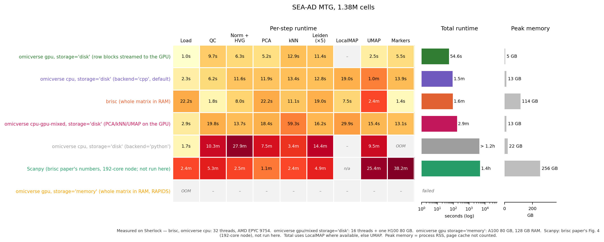

# Choosing storage and mode for large data

Two settings decide how omicverse runs a single-cell workflow:

1. **Where it is computed** — the mode, set once per session:
   `ov.settings.cpu_init()`, `ov.settings.cpu_gpu_mixed_init()` or `ov.settings.gpu_init()`.
2. **Where the matrix lives** — `storage` when reading an `.h5ad`
   (call it *after* choosing the mode):

```python
import omicverse as ov
ov.settings.gpu_init()                      # 1. compute on the GPU
adata = ov.read("data.h5ad", storage="disk")  # 2. keep the matrix on disk
```

| mode | `storage='memory'` | `storage='disk'` (default) |
|---|---|---|
| `cpu` | AnnData in RAM | AnnDataOOM: chunks streamed from disk by multithreaded C++ kernels |
| `cpu-gpu-mixed` | AnnData in RAM | AnnDataOOM; PCA, kNN, UMAP on the GPU |
| `gpu` | AnnData in RAM, moved to the GPU (RAPIDS) | Row blocks streamed from disk to the GPU (Dask) |

`ov.read("data.h5ad")` keeps the matrix on disk; pass `storage="memory"` for a
plain in-memory `anndata.AnnData` (for tools that need one, or when the file will
be overwritten while the object is in use).

The rest of the workflow (`ov.pp.qc`, `preprocess`, `scale`, `pca`, `neighbors`,
`leiden`, `umap`, `ov.single.find_markers`) is written the same way in all six
cases.

## Which one?

| your data | recommended |
|---|---|
| fits comfortably in RAM, no GPU | `cpu_init()` + `storage='memory'` |
| larger than RAM, no GPU | `cpu_init()` + `storage='disk'` |
| larger than RAM, one or more GPUs | `gpu_init()` + `storage='disk'` |
| fits in GPU memory | `gpu_init()` + `storage='memory'` |

`storage='disk'` keeps memory low but re-reads the file at every step, so it
runs fastest when the file sits on a local disk or in the page cache.
Uncompressed `.h5ad` files are read several times faster than gzip-compressed
ones.

## Example: 1.38 million cells

SEA-AD middle temporal gyrus atlas (1,378,211 nuclei × 36,601 genes, 7.6 billion
counts, 91 GB as float32 + int64 indices), the standard workflow from QC to
marker genes:



- `gpu` + `storage='disk'`: 55 s, 5 GB host memory on one H100.
- `cpu` + `storage='disk'`: 1.5 min, 13 GB on 32 CPU cores.
- `gpu` + `storage='memory'` cannot load this dataset with 128 GB of RAM.
- Scanpy (values reported by the brisc authors on a 192-core node): 1.4 h, 256 GB.

Peak memory is the process's resident memory; the operating system's page cache
holding the file is not counted.

## Advanced: the CPU kernels

In the `cpu` and `cpu-gpu-mixed` modes the CPU steps use multithreaded C++
kernels from [anndataoom-fast](https://pypi.org/project/anndataoom-fast/) by
default (`ov.settings.backend = 'cpp'`). Results do not depend on the number
of threads. `ov.settings.backend = 'python'` (or `backend='python'` on a single
function) selects the previous implementation.

## Limits of `gpu` + `storage='disk'`

Doublet detection, `pearson` normalisation and `seurat` HVGs in
`ov.pp.preprocess`, `no_cc`, and marker methods other than COSG need the whole
matrix and raise a clear error. `ov.read(..., layer='UMIs')` reads raw counts
stored in a layer as `X`. Several GPUs: `ov.settings.gpu_init(devices=[0, 1, 2, 3], dask=True)`.

Tutorials: [CPU](t_preprocess_cpu.ipynb) · [GPU, in memory](t_preprocess_gpu.ipynb) ·
[GPU, million cells from disk](t_preprocess_gpu_disk.ipynb) ·
[CPU, out of memory](t_preprocess_rust.ipynb)
